# Pipeline — De la voz al registro

> Contenido fuente del documento de pipeline. La versión oficial va en **Notion** (pública, enlazada en el README):
> copia este archivo en una página de Notion (Notion importa Markdown y renderiza los bloques Mermaid con `/code → Mermaid`).
> Este archivo queda como respaldo versionado.

## Vista general

```mermaid
flowchart TB
  subgraph ONCE["Corre UNA vez"]
    S[Guiones .yaml<br/>data/scripts] --> GT[Verdad de campo<br/>build_ground_truth.py]
    S --> REC[Grabación con compañero<br/>celular]
    REC --> COLAB[Colab GPU<br/>benchmark_asr.py<br/>transcribe_corpus.py]
    REC --> LAD[Escalera L1-L4<br/>build_ladder.py]
    LAD --> COLAB
    COLAB --> CACHE[(cache/transcripts<br/>versionado)]
    CACHE --> EVAL[evaluate.py<br/>sin GPU]
    GT --> EVAL
    EVAL --> RES[(results/*.json)]
    RES --> APP[app.py · Streamlit]
    RES --> CI[GitHub Actions<br/>regression_gate.py]
  end
  subgraph EACH["Corre en CADA audio nuevo · engine.process_audio()"]
    A[audio] --> ASR[ASR faster-whisper<br/>device leído del modelo + VRAM NVML]
    ASR --> NORM[Normalización numérica<br/>seis mil quinientos → 6500]
    NORM --> EXT{Extracción}
    EXT -->|reglas| R[regex + carta + glosario]
    EXT -->|llm| L[Claude JSON<br/>valor + evidencia]
    R --> VER[Verificación literal<br/>¿existe en la transcripción?]
    L --> VER
    VER -->|interview| REC1[Ficha de candidato]
    VER -->|order| VAL[Validación aritmética<br/>Σ q·p − promo = total]
    VAL --> DIAG[Diagnóstico<br/>error_asr / error_hablante]
    DIAG --> REC2[Registro de pedido]
  end
```

## Decisiones por paso (y lo que se descartó)

| Paso | Decisión | Descartado y por qué |
|---|---|---|
| Corpus | Guion escrito antes de grabar: la referencia y los campos cuestan cero | Subtítulos de YouTube como referencia: es otro ASR (evaluación circular) |
| Corpus | Cada campo cambia de posición y se dice "sucio" (rangos, autocorrecciones, cifras actuales vs pretendidas) | Un mismo guion con nombres cambiados: el extractor no generalizaría |
| ASR | faster-whisper (CTranslate2), `large-v3` int8_float16 por defecto | Se confirma o se cambia con la tabla de precisiones medida (float16 / int8_float16 / int8): completar con tus números |
| Prueba de GPU | `model.model.device` + VRAM por NVML durante la inferencia | Leer `device` del config: no prueba nada si cae a CPU en silencio |
| Glosario | `hotwords` (existe en la versión instalada: se inspecciona la firma) vs `initial_prompt`, medido con IC pareado | Asumir lo que dice la documentación pública (es inconsistente entre versiones) |
| Decodificación | Decodificador propio con PyAV | `faster_whisper.decode_audio`: falla con PyAV ≥ 15 (`metadata_errors`) |
| Normalización | Una sola regla para WER y para verificación (minúsculas, sin tildes, números a dígitos, sin puntuación) | Comparar texto crudo: un punto o una mayúscula contaría como error |
| Extracción | Dos rutas comparables: reglas y LLM con JSON schema estricto + evidencia literal | LLM libre que "corrige" lo que oyó mal: sin forma de auditar |
| Verificación | Valor sin evidencia literal → `sin_verificar` (nunca se descarta en silencio) | Coincidencia difusa: aceptaría números parecidos (6600 por 6500) |
| Pedido | Cruce Σ cantidad·precio − promoción = total dicho; carta en config | Confiar en el total dicho |
| Diagnóstico | error_asr si precio ≠ carta, baja confianza en el total, o con precios de carta sí cuadra; si no, error_hablante | Un solo umbral de confianza: no distingue un error del vendedor |
| Escalera | Opus 16 kbps (WhatsApp), 300–3400 Hz @ 8 kHz (teléfono), ruido a 5 dB SNR medida en tramas con voz + Opus; L4 = 0 dB + teléfono | "Agregar ruido" sin medir SNR |
| App | Solo lee `results/` y `cache/`; el probador llama a `process_audio()` | Transcribir el corpus al iniciar |
| CI | Recalcula métricas desde caché | Transcribir en el runner: no tiene GPU |
